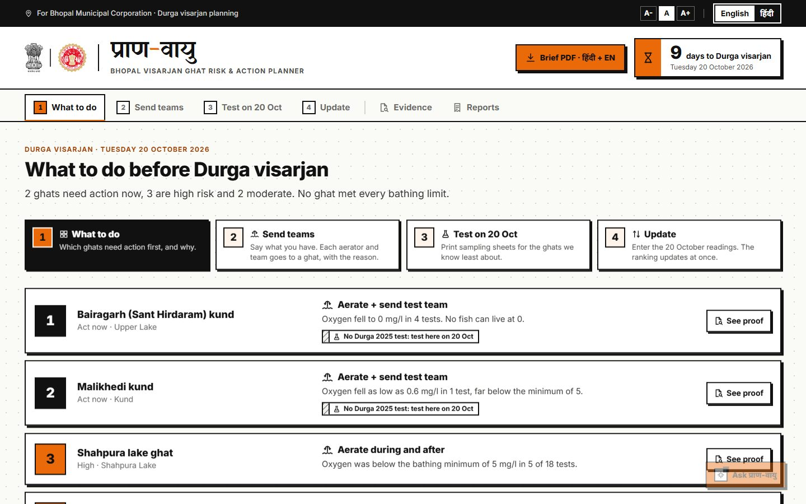
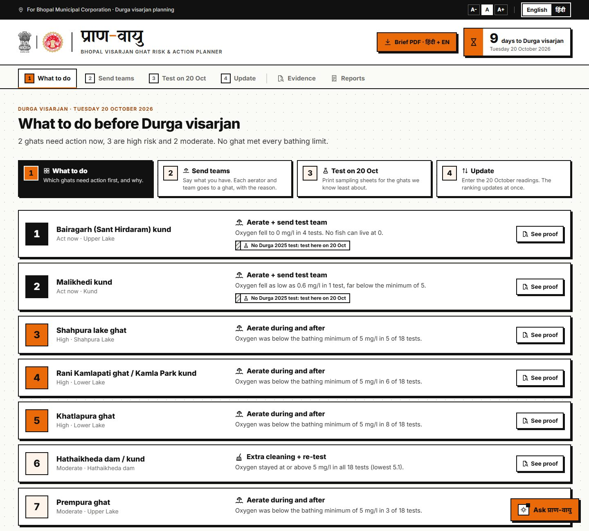
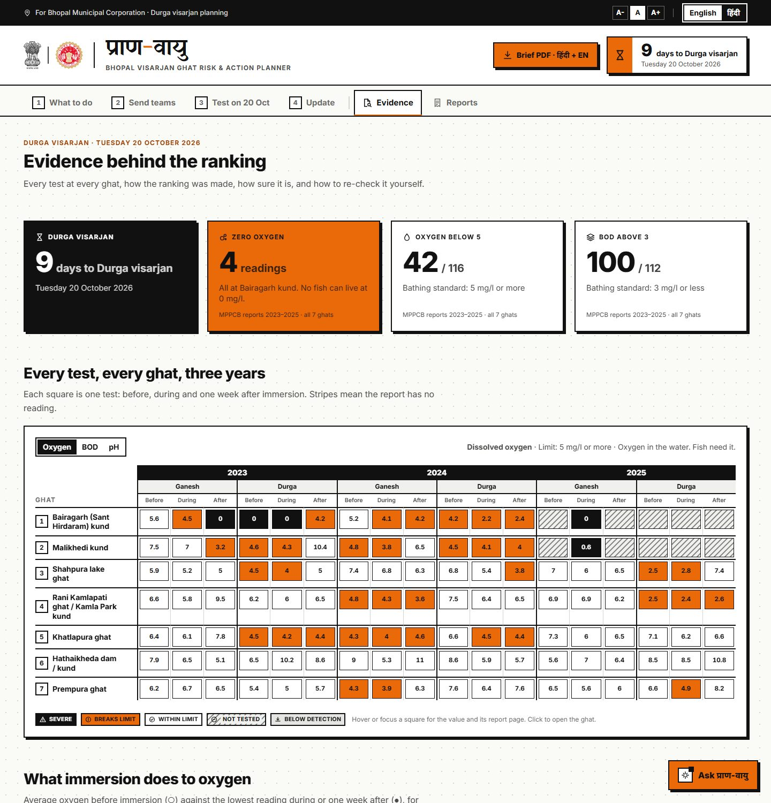
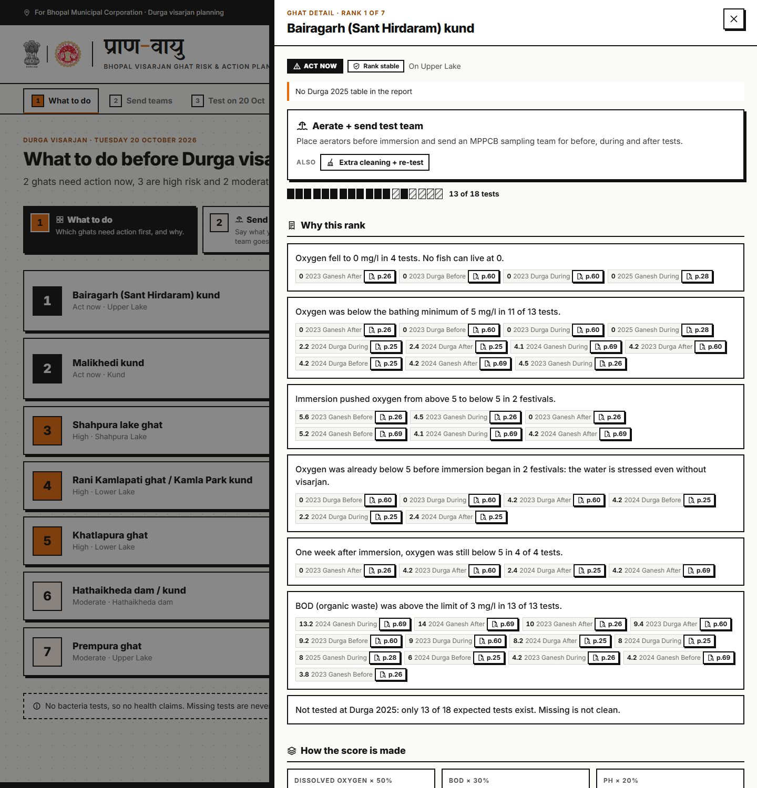
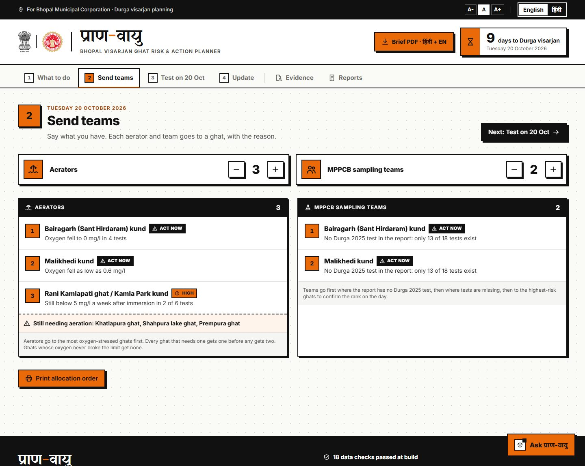
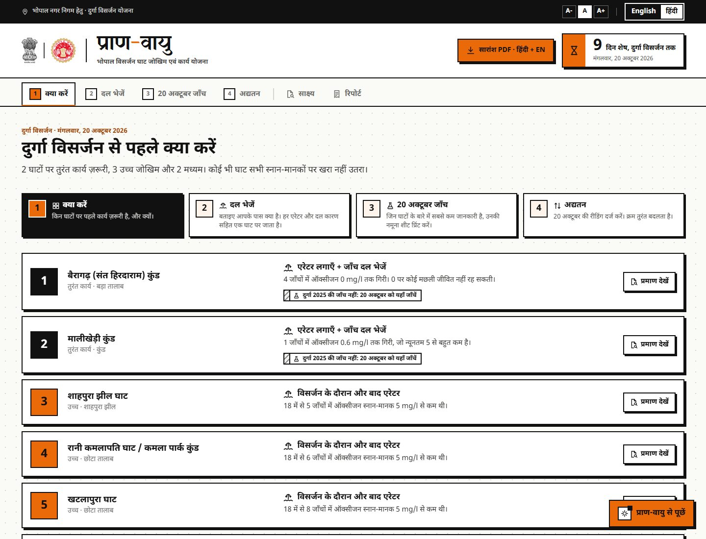
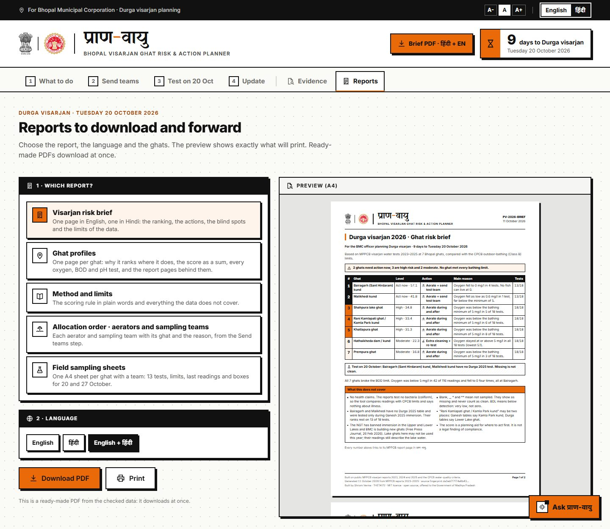

# प्राण-वायु

**Bhopal visarjan ghat risk and action planner**
Claude Impact Lab × Cerebras Café Compute, Bhopal · 11 October 2026 · **Track 2: Visarjan Ghat Watch**

| | |
|---|---|
| **Team** | THETA172 (solo) |
| **Member** | Shriom Verma |
| **Track** | Track 2: Visarjan Ghat Watch |
| **The one user** | The Bhopal Municipal Corporation officer who plans Durga visarjan at the ghats and decides where to send extra cleaning, aeration and water testing |
| **Live site** | https://pran-vayu-12vepjdot-theta-172.vercel.app (Vercel; every push to main redeploys) |



## What it does

Durga visarjan is on **Tuesday 20 October 2026**. Three years of MPPCB water tests at Bhopal's ghats sit in 90 to 120 page PDF reports. प्राण-वायु turns them into one decision for the officer: **which ghats need action first, what action, and why**, with every number traceable to the report page it came from.

**One workflow, four numbered steps** (the tabs follow them, so a non-technical officer always knows where they are):

| Step | Screen | What the officer does |
|---|---|---|
| **1** | **What to do** | Reads seven rows: each ghat's action and the reason in one line. Blind spots are flagged. "See proof" opens every reading behind it |
| **2** | **Send teams** | Says "I have 3 aerators and 2 sampling teams"; each goes to a ghat with the reason; prints the allocation order |
| **3** | **Test on 20 Oct** | Prints field sampling sheets for the ghats we know least about |
| **4** | **Update** | Enters the 20 October readings; the ranking updates at once and a **Today** status appears on step 1 |

**Evidence** (matrix, charts, robustness, statewide comparison, a *Check this tool* panel for organisers) and **Reports** (a report dashboard with live A4 preview) sit apart from the officer's steps. The **Brief PDF** button is in the header on every screen. An **AI assistant** answers questions and does tasks for the officer (see below).

| | What the officer gets |
|---|---|
| **Ranked ghats with reasons** | All 7 ghats ranked against the CPCB outdoor-bathing (Class B) limits, each with an action (aerate + test, test first, aerate, clean + re-test) and plain-language reasons |
| **Every number traceable** | Every reading opens the exact page of the MPPCB report PDF it came from (**Verify** buttons) |
| **Missing shown as missing** | Tests the reports don't have are striped "Not tested", never shown as clean. Bairagarh and Malikhedi rest on 13 of 18 tests and are flagged as blind spots |
| **Brief in Hindi and English** | A two-page PDF brief (one page per language) and a short WhatsApp message, built from the same checked numbers |
| **Honest about the data** | A "What this data can't tell you" box on the overview, in every brief and in the method document. No health claims: the reports test no bacteria |

### What makes it different

1. **Resource allocator.** "I have 3 aerators and 2 sampling teams": each goes to a ghat with the reason. Aerators go where oxygen is worst; teams go first where the report has no Durga 2025 test.
2. **Blind spots become a testing plan.** Missing data isn't hidden. It becomes printable field sampling sheets for 20 October, with the three MPPCB stages (before, during, one week after) and boxes for the readings.
3. **Before vs after immersion.** The tool separates water that is already low before visarjan from water that immersion itself pulls below the limit, because they need different action.
4. **A ranking you can trust.** The ranking is recomputed under 24 scoring choices (3 CPCB classes × Durga weight × year weight × parameter weights). Bairagarh is #1 in all 24; the ranks that move are shown as moving.
5. **Statewide context.** Each ghat's typical oxygen against 1,315 readings at other MP immersion sites ("lower than 92% of them" for Bairagarh).
6. **It keeps working on 20 October.** Officers enter the new readings; the ranking updates live and exports as CSV for MPPCB.
7. **Every number has a receipt.** An automated check opens the three MPPCB PDFs and confirms each of the 1,467 printed values appears on the page it cites.

## AI assistant

The orange **Ask प्राण-वायु** button opens an assistant for an officer with no time to look around. It answers in English or Hindi **only from the platform's checked data**, cites the report page for each reading, never makes health claims, and can **act in the platform**: open a ghat's evidence, plan aerators and teams with the allocator (and explain the result), download a report, switch language, or go to a step. Each action shows as a short animated line in the chat.

- Server function: [api/chat.ts](api/chat.ts) (Vercel), official `@anthropic-ai/sdk`, model `claude-opus-5-5` at low effort for quick replies, with the API's server-side refusal fallback enabled.
- The browser sends a plain-text summary of the checked data ([src/lib/assistantContext.ts](src/lib/assistantContext.ts)); the rules live on the server.
- **To switch it on:** Vercel project → Settings → Environment Variables → add `ANTHROPIC_API_KEY` → Redeploy. The key is never in the code or the browser.
- It runs on the deployed site only; on `npm run dev` the panel explains this.

## Similar systems elsewhere

| Where | What they built | What प्राण-वायु takes from it |
|---|---|---|
| **UK** (Environment Agency, "Swimfo") | Each bathing water is classified, with same-day pollution-risk warnings | The **Today** status on step 1 once 20 October readings are entered |
| **European Union** (Bathing Water Directive) | Sites tested each season, rated against limits, each with a public **bathing water profile** | Ratings against CPCB limits and one-page **ghat profiles** |
| **USA** (EPA BEACH Act; e.g. Chicago) | Beach advisories, some driven by same-day prediction models | Listed under next steps (needs rain/weather data we don't have) |
| **India** (CPCB idol-immersion guidelines; Kumbh Mela monitoring) | Water tested before, during and after immersion; monitoring stations at mass bathing events | This is the source of our data; the platform turns those tests into decisions |

Those systems test and warn. प्राण-वायु adds the decision: **where to send the officer's limited aerators and sampling teams, and where to test the places we are blind to, on visarjan day itself.**

## Next steps

- Same-day risk prediction from rainfall and temperature (as UK and US beach systems do), once weather data is added
- Sensor feeds into step 4 instead of manual entry (as at Kumbh Mela monitoring stations)
- A checklist of the CPCB idol-immersion guideline measures per ghat, checked against the official text
- Bacteria (coliform) tests at the ghats, without which no health statement can be made
- Ghat coordinates and a map; the official BMC logo; review of the Hindi text by BMC staff

## Screenshots

| ① What to do | Evidence |
|---|---|
|  |  |
| **See proof: every reading with its report page** | **② Send teams** |
|  |  |
| **हिंदी** | **Report dashboard** |
|  |  |

## How to run it

1. Install [Node.js](https://nodejs.org) 22.12 or later
2. `git clone https://github.com/shriomverma100/Pran-Vayu.git && cd Pran-Vayu`
3. `npm install`
4. `npm run dev`
5. Open the address it prints (usually http://localhost:5173)

No server, database, login or API key. The production build (`npm run build` → `dist/`) is a static site that runs from any web server or GitHub Pages, and works offline once loaded.

| Command | What it does |
|---|---|
| `npm run data` | Reads the official CSVs, checks every row, runs the 18 data checks, scores the ghats, writes `src/generated/data.json`. Stops if any check fails |
| `npm run verify` | Opens the three MPPCB PDFs and confirms every printed value is on its cited page |
| `npm test` | 60 tests: flag handling, limits, scoring (with hand-worked examples), robustness, statewide cleaning, allocator, field entries, brief |
| `npm run build` | Data + type check + production build |
| `npm run pdf` | Regenerates the PDFs in `public/pdfs/` with headless Chromium (run after any data or template change; needs `npx playwright install chromium` once) |

Useful links: `?lang=hi` opens in Hindi · `?nointro` skips the opening animation · `#ghats/BAI` opens one ghat · `#design` shows the design system.

## How the ranking works

1. Only the three tests with a CPCB bathing limit are scored: dissolved oxygen (5 mg/l or more), BOD (3 mg/l or less) and pH (6.5 to 8.5).
2. A reading within its limit scores 0. A reading that breaks it scores 50, plus up to 50 more for how far past the limit it is (oxygen at 0 scores 100).
3. Durga readings count 1.5×; 2024 and 2025 count 1.25× and 1.5×. Missing readings count nothing either way.
4. **Risk score = 50% oxygen + 30% BOD + 20% pH**, from 0 to 100. Every ghat page shows it as a sum, for example `0.5 × 67.3 + 0.3 × 78.2 + 0.2 × 0.0 = 57.1`.
5. **Act now:** score 55 or more, or any oxygen reading below 2 mg/l. **High:** 30 or more. **Moderate:** below 30. There is no "clean" tier: every ghat broke the BOD limit.

Result (CPCB Class B, default weights):

| # | Ghat | Score | Level | Action | Tests | Rank across 24 scorings |
|---|---|---|---|---|---|---|
| 1 | Bairagarh (Sant Hirdaram) kund | 57.1 | Act now | Aerate + send test team | 13/18 | #1 in all 24 |
| 2 | Malikhedi kund | 41.8 | Act now | Aerate + send test team | 13/18 | 2–4 |
| 3 | Shahpura lake ghat | 34.8 | High | Aerate during and after | 18/18 | 2–5 |
| 4 | Rani Kamlapati ghat / Kamla Park kund | 33.4 | High | Aerate during and after | 18/18 | 2–5 |
| 5 | Khatlapura ghat | 31.3 | High | Aerate during and after | 18/18 | 4–7 |
| 6 | Hathaikheda dam / kund | 22.3 | Moderate | Extra cleaning + re-test | 18/18 | 4–6 |
| 7 | Prempura ghat | 16.8 | Moderate | Aerate during and after | 18/18 | 5–7 |

## How we checked the numbers

- **18 build-time checks** reproduce the problem statement exactly: 1,524 readings · 42 of 116 oxygen readings below 5 mg/l · 100 of 112 BOD readings above 3 mg/l · 4 zero-oxygen readings, all at Bairagarh, in 2023 and 2025 · 174 below-detection and 61 missing readings · CPCB Class B limits. The build stops if any fails.
- **Receipt check:** every one of the 1,467 printed values, and its ghat's name, was found on the cited page of the MPPCB PDF.
- **Hand-worked scores** are in the tests (Bairagarh oxygen 67.3, Hathaikheda total 22.3, Bairagarh before/after means 3.75 → 1.58).
- **Source fingerprint:** SHA-256 of the input CSVs, shown in the footer and on every PDF, so anyone can confirm what the output came from.
- **One difference found and kept visible:** Bairagarh, Ganesh 2025, after-immersion pH is `**` in the CSV and `*` in the PDF (page 28). Both mean "not sampled", so no result changes.

## What works and what doesn't

**Works**
- The four officer steps (What to do, Send teams, Test on 20 Oct, Update), Evidence and Reports, in English (default) and Hindi
- Ranking, actions, reasons, Verify links to report pages, test coverage, rank stability, statewide comparison
- Ghat × test matrix, before/after-immersion chart, per-festival charts, full evidence table (scored tests or all 13)
- Resource allocator, field sampling sheets, allocation order, 20 October reading entry with validation, CSV export and live re-ranking
- PDFs: bilingual brief, ghat reports (English and Hindi), method and limits (English and Hindi); WhatsApp message with copy and share
- Government-style top bar (skip link, text size, language), keyboard navigation, reduced-motion support
- AI assistant on the deployed site once `ANTHROPIC_API_KEY` is set in Vercel
- Report dashboard: any report, language and ghat selection with a live A4 preview

**Doesn't, or only partly**
- **The AI assistant needs the API key in Vercel** and an internet connection; AI answers can be wrong, so the panel tells officers to check numbers with the Verify links.
- **BMC logo is not included.** No openly licensed copy was found, and downloading it from the BMC website would break the event's rule on government portals. Drop the official file at `src/assets/brand/bmc-logo.svg` (or `.png`) and it appears in the header and on every PDF.
- **20 October readings stay in one browser.** There is no server, by design, so readings are not shared between officers; use the CSV export.
- **Re-ranking with 20 October readings updates the scores and order only.** Blind-spot flags and the PDF brief still describe the 2023–2025 reports.
- **The PDFs are static files** made by `npm run pdf`. They must be regenerated after a data change (the screens update automatically).
- **No map.** The data pack has no ghat coordinates and no extra location data was added.
- **Hindi text was written for this build** and has not yet been reviewed by BMC staff; a review by a native speaker in the department is recommended before official use.
- **Statewide comparison is per reading, not per site,** because the statewide file spells site names differently across years.
- Tested in Chromium (desktop). Not yet tested on Firefox, Safari or phones, though the layout is responsive.

## What the data can't tell you

- **No health claims.** The reports test no bacteria (coliform); readings are compared with CPCB limits only.
- **Units are assumed.** The reports print none; the standard unit for each test is used.
- **Blank, `_`, `*` and `**` mean not sampled** and are never counted as clean. **BDL** is below detection: very low, not zero.
- **Bairagarh and Malikhedi** have no Durga 2025 table and were tested only during Ganesh 2025 immersion.
- **"Rani Kamlapati ghat / Kamla Park kund" may be two places** (Ganesh tables say Kamla Park kund; Durga tables say Lower Lake ghat).
- **Only four metals** (chromium, lead, zinc, copper) were tested and CPCB sets no bathing limit for them, so they are shown but not scored.
- **Three samples per festival** can miss what happens between them.
- **CPCB Class B** is used because people stand in the water during immersion; the ranking was also checked under Classes C and D.
- **The NGT has banned immersion in the Upper and Lower Lakes** and BMC is building new ghats. Lake ghats here may not be used this year; their readings still describe the lake water.
- The score is a **planning aid** for where to act first, not a legal finding of compliance.

## Data and sources

All data comes from the official participant pack ([Laaaaksh/bhopal-impact-lab-2026](https://github.com/Laaaaksh/bhopal-impact-lab-2026)). The files in `data/` are copied unchanged.

| File | Source |
|---|---|
| `data/bhopal_ghats_2023_2025.csv` | MPPCB Ganesh and Durga visarjan reports 2023, 2024, 2025 |
| `data/mp_immersion_sites_2023_2025.csv` | Same reports, all MP sites (background only, cleaned as described above) |
| `data/cpcb_water_quality_criteria.csv` | [CPCB water quality criteria](https://cpcb.gov.in/water-quality-criteria/) |
| `public/reports/mppcb-visarjan-2025.pdf` | [MPPCB Ganesh and Durga Visarjan Report 2025](https://www.mppcb.mp.gov.in/proc/mon/Ganesh_and_Durga_visarjan_report-2025.pdf) |
| `public/reports/mppcb-visarjan-2024.pdf` | [MPPCB Ganesh and Durga Visarjan Report 2024](https://www.mppcb.mp.gov.in/proc/mon/Ganesh_and_Durga_visarjan_report-2024.pdf) |
| `public/reports/mppcb-visarjan-2023.pdf` | [MPPCB Idol Immersion Report 2023 (CPCB format)](https://www.mppcb.mp.gov.in/proc/mon/Idol_immer._Report_23_CPCB.pdf) |

**Extra public material used** (not data): the State Emblem of India and the Emblem of Madhya Pradesh from Wikimedia Commons ([1](https://commons.wikimedia.org/wiki/File:Emblem_of_India.svg), [2](https://commons.wikimedia.org/wiki/File:Emblem_of_Madhya_Pradesh.svg)), shown in greyscale. Context from the pack's source list: [NGT immersion ban and new BMC ghats, Free Press Journal, 26 Feb 2026](https://www.freepressjournal.in/amp/bhopal/mp-news-idol-immersion-to-shift-from-lakes-to-safer-sites-ngt-ban-pushes-bmc-to-build-4-dedicated-ghats) and the [Durga visarjan date](https://www.drikpanchang.com/navratri/durga-puja/durga-visarjan-date-time.html?year=2026). No personal data is collected; field sheets ask for a team code, not names.

## Built with

TypeScript · React · Vite · Tailwind CSS · Motion (animation) · Anthropic SDK (assistant) · d3-scale (chart maths, all charts are hand-built SVG) · Zod (row checks) · PapaParse · pdf.js (receipt check) · Playwright (PDFs) · Vitest. Fonts: Yatra One (the name), Inter, Noto Sans Devanagari, all bundled for offline use. Built with Claude Code.

```
data/                 official CSVs, unchanged
public/reports/       the three MPPCB report PDFs (Verify links open these)
public/pdfs/          generated PDFs (npm run pdf)
api/chat.ts           AI assistant (Vercel function; key from ANTHROPIC_API_KEY)
scripts/              build-data (checks + scoring), verify-receipts, build-pdfs, screenshot
src/core/             data rules, scoring, robustness, statewide, allocator, field entries (no UI; tested)
src/components/       design system, charts, views, print templates
src/i18n/             English and Hindi text
tests/                60 tests
```

## Licence

[MIT](LICENSE) © 2026 Shriom Verma (THETA172). Offered to the Government of Madhya Pradesh through MPSeDC.
